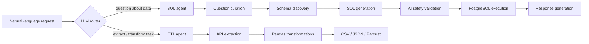

# Yashraj Rathor

  

---

## About

I'm a final-year B.E. Information Technology student at SIES Graduate School of Technology (University of Mumbai, CGPA 9.3/10). My work sits between data engineering and agentic AI: I build systems where LLM agents decide which tool to call, validate their own output, and run against real databases and APIs, and I build the data pipelines that feed them.

---

## General Info

| | |
|---|---|
| Name | Yashraj Radheshyam Rathor |
| Degree | B.E. Information Technology, SIES Graduate School of Technology (University of Mumbai) |
| CGPA | 9.3 / 10 |
| Location | Navi Mumbai, India |
| Focus | Agentic AI, data engineering, RAG |
| Contact | yashrajrathor2005@gmail.com |

---

## Featured Project: Agentic AI Data Analyst and ETL Automation Agent

A multi-agent system that takes a natural-language request and routes it to the right specialist: a SQL agent for questions about data, or an ETL agent for extraction and transformation jobs.

- **Routing:** an LLM-based router decides between the SQL agent and the ETL agent for each request.
- **SQL agent:** a 7-stage workflow covering question curation, schema discovery, SQL generation, AI-based safety validation, PostgreSQL execution, and response generation. The validation stage checks generated queries before they touch the database.
- **ETL agent:** tool-driven workflows for API extraction and Pandas transformations, with output in CSV, JSON or Parquet.
- **Stack:** Python, LangGraph, LangChain, PostgreSQL, Pandas.

---

## Other Projects

**Spotify End-to-End Data Engineering Pipeline on Azure** (Jul 2026 - Present)
Parameterized, metadata-driven ingestion in Azure Data Factory into Azure Data Lake Storage Gen2, with incremental loading and backfilling. Data is organized in a Bronze / Silver / Gold medallion architecture, with cleaning, transformation and validation done in Azure Databricks using PySpark.

**Memora Semantic Learning System** (Sep 2025 - Jun 2026)
A learning assistant built on Retrieval-Augmented Generation. It includes a document retrieval pipeline for educational content, semantic search, and answers generated from vector embeddings.

---

## Skills

| Area | Tools |
|---|---|
| Agentic AI | LangGraph, LangChain, RAG, multi-agent routing, vector embeddings |
| Data engineering | Azure Data Factory, Azure Data Lake, Databricks, PySpark, ETL |
| Languages and data | Python, SQL, OOP, Pandas, NumPy, PostgreSQL, MySQL |
| Tooling | Git, GitHub, CI/CD, Jupyter, Postman |

---

## Competitive Programming

---

## Experience

**Data Science Intern, Reva Technologies** (Jun - Jul 2025)
Analysed climate datasets with Python and SQL for rainfall forecasting, built and evaluated machine learning models for weather prediction, and did preprocessing and feature engineering to improve accuracy.

## Education

- **B.E. Information Technology**, SIES Graduate School of Technology, University of Mumbai. CGPA 9.3/10 (Aug 2023 - Present)
- 12th, Science, Shiravane Vidyalaya and Junior College. 65.17% (2021 - 2023)
- 10th, St. Xavier's High School and Jr. College, Maharashtra State Board. 89.00% (2020 - 2021)

## Certifications and Awards

- IBM (Coursera): Python for Data Science, AI and Development
- IBM (Coursera): Essential Tools for Data Scientists
- Postman: API Fundamentals Student Expert
- Second Prize, Cognition 2025 (SIES GST): led planning and execution of an AI-powered healthcare platform
- Class Representative, Student Council (2024 - 2025)

---

## GitHub Activity

  

---

yashrajrathor2005@gmail.com | Navi Mumbai, India

